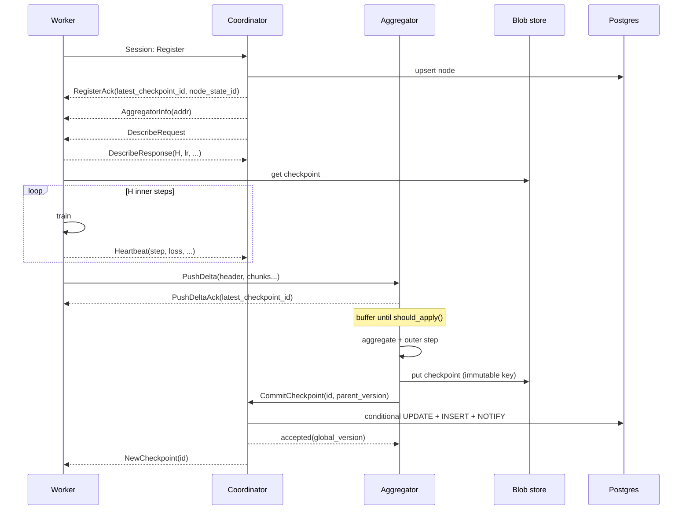

# Ferry — Design Spec (v1)

This document specifies v1 of Ferry: components, protocol, data model, training flow and failure handling. For an
overview, see [README.md](./README.md).

---

## 1. Goals and non-goals

### Goals (v1)

- Coordinate N workers and 1 aggregator training a shared model with infrequent communication.
- Allow **heterogeneous workers**: each worker chooses its own `H` (inner steps per round) and config.
- **Never block** a worker on another worker, and never discard a worker's completed GPU work because a peer or the
  aggregator was unavailable.
- Recover any node (worker or aggregator) from the last persisted state on re-registration.
- Keep the control plane free of tensor data.
- Pluggable aggregation strategy, outer optimizer, blob store and metadata store.

### Non-goals (v1)

- Coordinator high availability or replication.
- More than one active aggregator (multi-aggregator / sharded aggregation).
- A central job spec, scheduler or autoscaling.
- Large-model techniques: parameter sharding, Streaming DiLoCo fragments, delta quantization.
- Security beyond transport TLS (no auth/authz model yet).

---

## 2. Terminology

| Term                | Meaning                                                                                         |
|---------------------|-------------------------------------------------------------------------------------------------|
| **Coordinator**     | The control plane. The only address every component is configured with.                         |
| **Aggregator**      | Node that combines worker deltas and applies the outer optimizer step.                          |
| **Worker**          | Node that trains locally (inner loop) and produces deltas.                                      |
| **Inner step**      | One local optimizer step (e.g. AdamW) on a worker.                                              |
| **H**               | Number of inner steps a worker runs before pushing a delta. Per-worker.                         |
| **Base checkpoint** | The global checkpoint a worker started its current local run from.                              |
| **Delta**           | `θ_local − θ_base`: how a worker's weights moved since its base checkpoint.                     |
| **Outer gradient**  | `−delta`, i.e. `θ_base − θ_local`. The input to the outer optimizer (DiLoCo convention).        |
| **Global version**  | Monotonic counter, incremented every time the aggregator commits a new global checkpoint.       |
| **Staleness**       | `current_global_version − base_global_version` for a delta.                                     |
| **Epoch**           | Aggregator generation number, incremented on each aggregator registration. Unrelated to rounds. |
| **Session**         | Long-lived bidi gRPC stream between a node and the coordinator.                                 |

---

## 3. Architecture

### 3.1 Components and responsibilities

**Coordinator**

- Accepts registrations from workers and the aggregator; assigns node IDs; tracks sessions and leases.
- On worker connect, requests the worker's config over the session stream (connection test). Drops the session if no
  valid reply arrives within the timeout.
- Maintains the **checkpoint registry**: the latest committed global checkpoint ID and history.
- Tells nodes where things are: aggregator address, latest checkpoint ID, a node's last persisted state.
- Notifies workers when a new global checkpoint is committed.
- Persists everything in Postgres. Holds no tensors.

**Aggregator**

- Registers with the coordinator; on (re)registration receives the latest checkpoint ID and restores global params and
  outer optimizer state from blob storage.
- Exposes `PushDelta` for workers.
- Buffers deltas per the `AggregationPolicy`, combines them via `Aggregator`, applies `OuterOptimizer`.
- Writes the new checkpoint to blob storage, **then** commits its ID to the coordinator.

**Worker**

- Registers with the coordinator, reports its config, receives aggregator address + latest checkpoint ID + its own
  last persisted state.
- Downloads the base checkpoint from blob storage and runs `H` inner steps.
- Pushes its delta to the aggregator, tagged with base checkpoint/version metadata.
- Pulls the latest checkpoint and starts its next local run.
- Keeps its inner optimizer state (AdamW moments) locally across runs. Inner state is never sent.

### 3.2 Connectivity rules

1. Every component **dials out** to the coordinator. No component dials a worker.
2. Workers discover the aggregator's address from the coordinator, then dial the aggregator for `PushDelta`.
3. Workers and the aggregator access blob storage directly using IDs/URIs from the coordinator.
4. The coordinator never proxies tensors.

### 3.3 Planes

| Plane         | Carries                                                    | Transport                                 |
|---------------|------------------------------------------------------------|-------------------------------------------|
| Control plane | Registration, config, heartbeats, checkpoint notifications | `Coordinator.Session` (bidi stream)       |
| Data plane    | Deltas                                                     | `Aggregator.PushDelta` (client streaming) |
| Storage plane | Checkpoints, persisted node state                          | Blob store (FS / S3 / ...)                |

Large payloads are never sent on the session stream, so uploads cannot delay heartbeats (no head-of-line blocking on
the control plane).

---

## 4. Protocol

gRPC with protobuf. Tensor payloads are **safetensors** blobs, split into chunks of at most 1 MB.

```protobuf
syntax = "proto3";
package ferry.v1;

// ───────────────────────── Coordinator ─────────────────────────

service Coordinator {
  // Long-lived control-plane stream. First message from the node must be Register.
  rpc Session(stream NodeMsg) returns (stream CoordinatorMsg);

  // Aggregator only: commit a checkpoint that is already fully persisted in blob storage.
  rpc CommitCheckpoint(CommitCheckpointRequest) returns (CommitCheckpointResponse);
}

enum NodeType {
  NODE_TYPE_UNSPECIFIED = 0;
  NODE_TYPE_WORKER      = 1;
  NODE_TYPE_AGGREGATOR  = 2;
}

message NodeMsg {
  oneof msg {
    Register         register  = 1;
    DescribeResponse describe  = 2;
    Heartbeat        heartbeat = 3;
    StateUpdate      state     = 4;
  }
}

message CoordinatorMsg {
  oneof msg {
    RegisterAck     register_ack   = 1;
    DescribeRequest describe       = 2;
    NewCheckpoint   new_checkpoint = 3;
    AggregatorInfo  aggregator     = 4;  // sent on register and whenever the active aggregator changes
    Shutdown        shutdown       = 5;
  }
}

message Register {
  NodeType type        = 1;
  string   node_id     = 2;  // empty on first registration; reuse to resume
  string   advertise_addr = 3;  // aggregator only: address workers should dial
  string   version     = 4;  // Ferry version
}

message RegisterAck {
  string node_id              = 1;
  uint64 epoch                = 2;  // aggregator only (see §8.2)
  string latest_checkpoint_id = 3;  // empty if training has not started
  uint64 latest_global_version = 4;
  string node_state_id        = 5;  // last persisted per-node state, empty if none
}

message DescribeRequest {}

message DescribeResponse {
  // Worker-owned config. Opaque keys allowed; well-known keys below.
  uint32 h              = 1;
  double inner_lr       = 2;
  uint32 batch_size     = 3;
  string device         = 4;  // e.g. "cuda:0", "A100-80GB"
  map<string, string> extra = 15;
}

message Heartbeat {
  NodeState state          = 1;
  uint64    base_global_version = 2;
  uint32    inner_step     = 3;  // progress within the current local run
  double    loss           = 4;
  double    samples_per_sec = 5;
  double    gpu_util       = 6;
}

enum NodeState {
  NODE_STATE_UNSPECIFIED = 0;
  NODE_STATE_JOINING     = 1;
  NODE_STATE_IDLE        = 2;
  NODE_STATE_TRAINING    = 3;
  NODE_STATE_UPLOADING   = 4;
  NODE_STATE_AGGREGATING = 5;  // aggregator only
}

message StateUpdate {
  // A node persisted its own resumable state to blob storage.
  string node_state_id = 1;
}

message NewCheckpoint {
  string checkpoint_id  = 1;
  uint64 global_version = 2;
  string uri            = 3;
}

message AggregatorInfo {
  string addr  = 1;
  uint64 epoch = 2;
}

message Shutdown { string reason = 1; }

message CommitCheckpointRequest {
  string aggregator_id  = 1;
  uint64 epoch          = 2;
  string checkpoint_id  = 3;
  string uri            = 4;
  uint64 parent_version = 5;  // global version this checkpoint was built on
  repeated string delta_ids = 6;  // deltas folded into this checkpoint
}

message CommitCheckpointResponse {
  bool   accepted       = 1;
  uint64 global_version = 2;
  string reason         = 3;  // set when rejected
}

// ───────────────────────── Aggregator ─────────────────────────

service Aggregator {
  rpc PushDelta(stream DeltaChunk) returns (PushDeltaAck);
}

message DeltaChunk {
  // Header fields are required on the first chunk (seq = 0) and ignored after.
  DeltaHeader header = 1;
  uint32      seq    = 2;
  bytes       data   = 3;  // slice of a safetensors blob
  bool        last   = 4;
}

message DeltaHeader {
  string delta_id            = 1;  // UUID, used for idempotent retries
  string worker_id           = 2;
  string base_checkpoint_id  = 3;
  uint64 base_global_version = 4;
  uint32 inner_steps         = 5;  // actual steps covered by this delta (may exceed H, see §7.1)
  uint64 num_samples         = 6;
  double local_loss          = 7;
  uint64 total_bytes         = 8;
  string sha256              = 9;
}

message PushDeltaAck {
  bool   accepted              = 1;
  string reason                = 2;  // e.g. "too_stale", "duplicate"
  string latest_checkpoint_id  = 3;
  uint64 latest_global_version = 4;
}
```

### 4.1 Session rules

- First message on `Session` must be `Register`. Anything else closes the stream.
- **Workers:** after `RegisterAck`, the coordinator sends `DescribeRequest`. The worker must reply with
  `DescribeResponse` within `describe_timeout` (default 10 s), or the coordinator closes the session. The response
  is stored as the worker's reported config.
- Heartbeats every `heartbeat_interval` (default 5 s). Each heartbeat renews the node's lease.
- gRPC keepalives are enabled on all channels to detect dead TCP connections; they do **not** replace heartbeats.

### 4.2 Chunking

- Max chunk payload: 1 MB. Max total message size configured above that (e.g. 4 MB).
- The receiver reassembles chunks in `seq` order, checks `total_bytes` and `sha256`, then parses safetensors.
- Pickle (`torch.save` / `torch.load`) is never used on any network or blob path.

---

## 5. Data model (Postgres)

```sql
CREATE TABLE nodes (
    node_id          TEXT PRIMARY KEY,
    node_type        TEXT NOT NULL CHECK (node_type IN ('worker', 'aggregator')),
    state            TEXT NOT NULL,               -- JOINING | IDLE | TRAINING | UPLOADING | AGGREGATING | SUSPECT | DEAD
    advertise_addr   TEXT,                        -- aggregator only
    reported_config  JSONB,                       -- worker DescribeResponse
    last_heartbeat   JSONB,                       -- latest Heartbeat payload
    lease_expires_at TIMESTAMPTZ,
    node_state_id    TEXT,                        -- last persisted resumable state (blob ID)
    registered_at    TIMESTAMPTZ NOT NULL DEFAULT now(),
    updated_at       TIMESTAMPTZ NOT NULL DEFAULT now()
);

-- Single row: the active aggregator and the latest committed global checkpoint.
CREATE TABLE aggregator_state (
    id                   BOOLEAN PRIMARY KEY DEFAULT TRUE CHECK (id),
    active_aggregator_id TEXT REFERENCES nodes(node_id),
    epoch                BIGINT NOT NULL DEFAULT 0,     -- see §8.2
    latest_checkpoint_id TEXT,
    global_version       BIGINT NOT NULL DEFAULT 0,
    updated_at           TIMESTAMPTZ NOT NULL DEFAULT now()
);

CREATE TABLE checkpoints (
    checkpoint_id   TEXT PRIMARY KEY,
    global_version  BIGINT NOT NULL UNIQUE,
    parent_version  BIGINT,
    uri             TEXT NOT NULL,
    aggregator_id   TEXT NOT NULL,
    epoch           BIGINT NOT NULL,
    delta_ids       TEXT[] NOT NULL DEFAULT '{}',
    created_at      TIMESTAMPTZ NOT NULL DEFAULT now()
);

-- Audit log of deltas the aggregator accepted or rejected.
CREATE TABLE deltas (
    delta_id            TEXT PRIMARY KEY,
    worker_id           TEXT NOT NULL,
    base_global_version BIGINT NOT NULL,
    inner_steps         INT NOT NULL,
    num_samples         BIGINT NOT NULL,
    status              TEXT NOT NULL,              -- accepted | rejected | applied
    reason              TEXT,
    received_at         TIMESTAMPTZ NOT NULL DEFAULT now()
);
```

### 5.1 Committing a checkpoint

Run in one transaction by the coordinator when it handles `CommitCheckpoint`:

```sql
UPDATE aggregator_state
SET latest_checkpoint_id = $checkpoint_id,
    global_version       = global_version + 1,
    updated_at           = now()
WHERE active_aggregator_id = $aggregator_id
  AND global_version       = $parent_version
  -- AND epoch             = $epoch          -- enforced once fencing is enabled (§8.2)
RETURNING global_version;

INSERT INTO checkpoints (...) VALUES (...);
NOTIFY ferry_checkpoint, '<checkpoint_id>';
```

If the `UPDATE` affects zero rows, the commit is rejected and the transaction rolls back. The coordinator's
`LISTEN ferry_checkpoint` handler pushes `NewCheckpoint` to all worker sessions.

---

## 6. Interfaces

Python sketches; names are normative, signatures indicative.

```python
class Aggregator(Protocol):
    """Combines a batch of deltas into one outer gradient."""

    def aggregate(self, deltas: list[Delta], current_version: int) -> OuterGradient: ...
    # Implementations: Mean, SampleWeightedMean, StalenessWeightedMean, TrimmedMean


class OuterOptimizer(Protocol):
    """Applies an outer gradient to the global parameters. Stateful; state is checkpointed."""

    def step(self, params: StateDict, outer_grad: OuterGradient) -> StateDict: ...

    def state_dict(self) -> StateDict: ...

    def load_state_dict(self, state: StateDict) -> None: ...
    # SGD(lr=1.0, momentum=0)  == FedAvg
    # SGD(lr=0.7, nesterov, momentum=0.9) == DiLoCo
    # Adam == FedAdam


class AggregationPolicy(Protocol):
    """Decides when buffered deltas are applied and which deltas are accepted."""

    def accept(self, header: DeltaHeader, current_version: int) -> tuple[bool, str]: ...

    def should_apply(self, buffer: list[Delta], now: float) -> bool: ...
    # e.g. BufferK(k=4, max_wait_s=30, max_staleness=8)


class WorkerStateHandler(Protocol):
    """Implemented by the user's training code. Persists and restores resumable worker state."""

    def save(self) -> bytes: ...  # inner optimizer state, data cursor, RNG state, step counters

    def restore(self, blob: bytes) -> None: ...


class BlobStore(Protocol):
    def put(self, key: str, data: bytes | BinaryIO) -> str: ...  # returns URI; must be atomic per key

    def get(self, uri: str) -> BinaryIO: ...

    def delete(self, uri: str) -> None: ...
    # Implementations: LocalFS, S3


class MetadataStore(Protocol):
    # Postgres implementation in v1. Kept behind an interface for testing (in-memory) and future etcd.
    ...
```

---

## 7. Training flow

### 7.1 Worker lifecycle

```
JOINING ──register+describe──► IDLE ──pull checkpoint──► TRAINING ──H steps──► UPLOADING ──ack──► IDLE ─┐
   ▲                                                                                                    │
   └──────────────────────────── session lost / re-register ◄───────────────────────────────────────────┘
```

1. **Register.** Open `Session`, send `Register` (reuse `node_id` if resuming). Receive `RegisterAck` and
   `AggregatorInfo`.
2. **Describe.** Answer `DescribeRequest` with local config.
3. **Restore.** If `node_state_id` is set, fetch it and call `WorkerStateHandler.restore()` (inner optimizer state,
   data cursor). Model parameters are **always** loaded from `latest_checkpoint_id`, never from the worker's own old
   weights.
4. **Train.** Record `θ_base` and `base_global_version`. Run `H` inner steps.
5. **Push.** Compute `delta = θ_local − θ_base`, serialize to safetensors, stream via `PushDelta`.
6. **Resume.**
    - On ack: download the checkpoint from `latest_checkpoint_id` in the ack and go to step 4.
    - On failure (aggregator unreachable, timeout): **do not discard work.** Keep `θ_local` and the same `θ_base`,
      run another `H` steps, and push again. The next delta covers all steps since the base (`inner_steps = 2H`,
      `3H`, ...).
7. **Persist state** periodically via `WorkerStateHandler.save()` → blob store → `StateUpdate`.

`NewCheckpoint` notifications received mid-run are recorded but do not interrupt the current local run. The worker
picks up the newest checkpoint at step 6.

### 7.2 Aggregator loop

1. **Register.** Receive `epoch` and `latest_checkpoint_id`. Restore global params **and outer optimizer state** from
   that checkpoint. If none exists, initialize the model and commit version 0.
2. **Receive deltas.** For each `PushDelta`:
    - Reassemble and verify chunks.
    - Deduplicate by `delta_id` (retries are idempotent).
    - Call `AggregationPolicy.accept()`; reject with a reason if too stale or invalid.
    - Add to buffer; ack with the current latest checkpoint.
3. **Apply.** When `AggregationPolicy.should_apply()` is true:
    - `outer_grad = Aggregator.aggregate(buffer, current_version)`
    - `params = OuterOptimizer.step(params, outer_grad)`
4. **Persist, then publish.**
    - Write `{params, outer_optimizer_state, global_version, policy_state}` to the blob store under an immutable key
      `checkpoints/{global_version:08d}-{short_hash}.safetensors`.
    - Call `CommitCheckpoint`. If rejected, stop and re-register (another aggregator is active).
5. Clear the buffer and continue.

### 7.3 Normalization and staleness

Because workers run different `H` and may push stale deltas, raw deltas are not comparable.

- **Step normalization.** A delta covering more inner steps is larger. Default `Aggregator` weights each delta by
  `num_samples` and normalizes by `inner_steps` so fast workers do not act as a larger learning rate.
- **Staleness.** `staleness = current_version − base_global_version`. Default policy:
    - reject if `staleness > max_staleness` (default 8);
    - otherwise weight by `1 / (1 + staleness)`.
- **Outer momentum under async.** Applying Nesterov momentum on every single delta is unstable. Default
  `AggregationPolicy` buffers `k` deltas (or waits `max_wait_s`) before an outer step. `k = 1` is supported but
  recommended only with a momentum-free outer optimizer (FedAvg). Delayed Nesterov (Liu et al., 2024) is a planned
  `OuterOptimizer`.

### 7.4 Sequence: register → train → push → checkpoint



---

## 8. Failure handling

### 8.1 Leases and node states

- Lease TTL = `3 × heartbeat_interval`. Missed lease → `SUSPECT`; `2 × TTL` → `DEAD`.
- A `DEAD` worker's in-flight work is not waited on by anything (no barriers), so dead workers cost nothing but their
  missing contribution.
- A node returning with the same `node_id` resumes from its last `node_state_id`.

### 8.2 Scenarios

| Scenario                                               | Behavior                                                                                                                                                                                                                                   |
|--------------------------------------------------------|--------------------------------------------------------------------------------------------------------------------------------------------------------------------------------------------------------------------------------------------|
| **Worker crashes**                                     | Lease expires, marked `DEAD`. On restart it re-registers with the same `node_id`, restores inner state, loads the latest global checkpoint.                                                                                                |
| **Worker loses session mid-run**                       | Keeps training. Reconnects with backoff. Pushes when the aggregator is reachable.                                                                                                                                                          |
| **Aggregator unreachable during push**                 | Worker retries the push after its next `H` steps with an accumulated delta from the same base (§7.1 step 6). Retries reuse `delta_id` only for the identical payload.                                                                      |
| **Aggregator crashes before commit**                   | Buffered deltas since the last commit are lost; an orphaned blob may remain (harmless, GC'd later). Workers have already been acked, so v1 accepts this loss. On restart the aggregator restores from the latest committed checkpoint.     |
| **Aggregator crashes after blob write, before commit** | Same as above. The coordinator never saw the ID, so nothing points at the blob.                                                                                                                                                            |
| **New aggregator registers**                           | Coordinator increments `epoch`, sets it as `active_aggregator_id`, pushes `AggregatorInfo` to all workers. The new aggregator restores from the latest committed checkpoint.                                                               |
| **Coordinator down**                                   | Nodes cannot register or report health. Workers continue local training; pushes to an already-known aggregator continue. The aggregator cannot commit checkpoints and keeps them buffered/persisted locally until the coordinator returns. |
| **Postgres down**                                      | Treated as coordinator down.                                                                                                                                                                                                               |

### 8.3 Split brain (deferred — marked for review)

v1 assumes exactly one aggregator. The schema already carries an `epoch` (aggregator generation number, incremented
on each aggregator registration; it is independent of worker rounds and global version). Enforcement plan:

- `CommitCheckpoint` includes `epoch`; the conditional `UPDATE` adds `AND epoch = $epoch`.
- A zero-row update means the caller is a stale aggregator; it must shut down.
- Workers reject `PushDeltaAck`s whose epoch is older than the latest `AggregatorInfo` they have seen.

Until this is enabled, operators must ensure a replaced aggregator is actually stopped. The `global_version =
$parent_version` check in §5.1 already prevents two aggregators from both committing on top of the same version.

---

## 9. Configuration

### Coordinator

| Key                    | Default        | Notes                                                 |
|------------------------|----------------|-------------------------------------------------------|
| `listen_addr`          | `0.0.0.0:7070` |                                                       |
| `postgres_dsn`         | —              | required                                              |
| `heartbeat_interval_s` | 5              | sent to nodes in `RegisterAck` (future)               |
| `describe_timeout_s`   | 10             |                                                       |
| `checkpoint_retention` | 20             | number of committed checkpoints kept; older ones GC'd |

### Aggregator

| Key                  | Default                                         | Notes                    |
|----------------------|-------------------------------------------------|--------------------------|
| `coordinator_addr`   | —                                               | required                 |
| `advertise_addr`     | —                                               | address workers dial     |
| `blob_store`         | `file://./ferry-data`                           | `file://`, `s3://`       |
| `outer_optimizer`    | `nesterov(lr=0.7, momentum=0.9)`                | `sgd(lr=1.0)` for FedAvg |
| `aggregation_policy` | `buffer_k(k=4, max_wait_s=30, max_staleness=8)` |                          |

### Worker

| Key                   | Default         | Notes                                      |
|-----------------------|-----------------|--------------------------------------------|
| `coordinator_addr`    | —               | required                                   |
| `node_id`             | —               | set to resume as the same node             |
| `h`                   | 500             | inner steps per local run                  |
| `inner_optimizer`     | `adamw(lr=...)` | state kept locally                         |
| `state_persist_every` | 1 run           | how often `WorkerStateHandler.save()` runs |

---

## 10. Observability

Every component exports Prometheus metrics and structured logs. Minimum set:

- **Worker:** `inner_steps_total`, `samples_per_sec`, `local_loss`, `push_duration_seconds`, `push_bytes`,
  `push_failures_total`, `time_blocked_seconds` (should stay ≈ 0).
- **Aggregator:** `deltas_received_total{status}`, `delta_staleness` (histogram), `outer_steps_total`,
  `checkpoint_write_seconds`, `global_version`.
- **Coordinator:** `nodes{type,state}`, `lease_expirations_total`, `commit_rejections_total`.

Headline experiment plots: loss vs wall-clock time and loss vs bytes communicated, Ferry vs a DDP baseline, with
simulated slow workers and throttled bandwidth (`tc netem`).

---

## 11. Open questions and future work

- **Split-brain fencing** (§8.3): enable epoch enforcement.
- **Aggregator buffer durability:** persist accepted-but-unapplied deltas so an aggregator crash loses nothing.
- **Coordinator HA:** replicate the coordinator; consider etcd for leader election and watches.
- **Delayed Nesterov** and **dynamic local updates** (coordinator suggests per-worker `H` from observed throughput).
- **Streaming DiLoCo:** sync parameter fragments on a staggered schedule.
- **Delta compression:** int8 / 4-bit quantization, top-k sparsification.
- **AuthN/Z:** mTLS between nodes, per-node credentials.
- **Checkpoint GC** policy and orphan-blob sweeping.